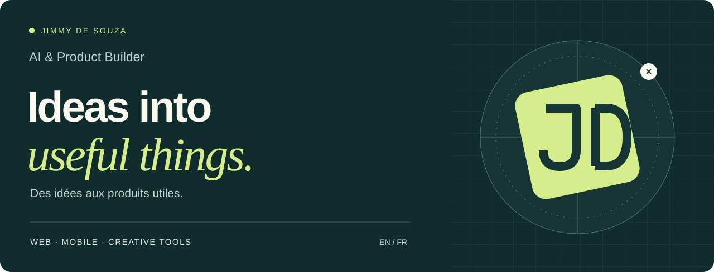

[English / Bilingual profile](README.md) · [Portfolio ↗](https://jimmyaiproductbuilder.vercel.app)

# Jimmy de Souza · AI & Product Builder

Je transforme des idées en produits utiles : expériences web, applications mobiles et outils créatifs. J’utilise l’IA pour explorer, construire et itérer. Mon parcours dans l’audiovisuel nourrit ma façon de concevoir : une intention claire, une expérience soignée et le souci du détail.

## Projets sélectionnés

### [MonAdresse ↗](https://www.monadresse.co/)

Créer et partager une adresse numérique claire, avec des repères, des photos et des indications audio. Un produit web et mobile conçu pour aider les gens à trouver un lieu plus facilement.

Présentation publique ; code source privé.

### [Rooturn ↗](https://rooturn.vercel.app)

Un projet documentaire sur le Bénin, les parcours de retour et les vies qui se réinventent. Réalisation : Jimmy de Souza.

Le site est en ligne et le premier film est disponible. Le projet documentaire se poursuit.

### [SRTB · Plateforme web ↗](https://site-srtb-desouzajimmyjds-2193s-projects.vercel.app)

Une nouvelle expérience média qui réunit actualité, télévision en direct, replay, podcasts et programmes, avec un CMS pour les équipes éditoriales.

La nouvelle version n’est pas encore déployée publiquement. L’aperçu Vercel est protégé et peut demander une connexion. Ce lien ne constitue pas le lancement officiel du site.

### [SRTB Graphics ↗](https://github.com/jimdsz/srtb-graphics)

Un studio web d’habillage TV : du brief programme à la vidéo à valider. Le dépôt public présente le code, l’architecture, l’installation et les limites documentées.

React · TypeScript · WebCodecs · Cloudflare.

## Ma façon de construire

**Comprendre → Concevoir → Construire → Affiner.**

Je pars d’un besoin concret. Je travaille la clarté de l’expérience, puis j’itère sur le produit avec l’aide de l’IA. Je privilégie les interfaces lisibles, les interactions soignées et une gestion attentive des données.

**Outils :** TypeScript, React, Next.js, React Native, Expo, outils d’IA et narration audiovisuelle.

---

**Des produits utiles. Des expériences soignées. Des histoires qui comptent.**
