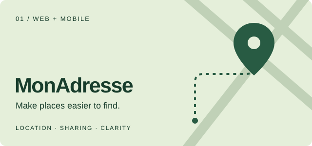
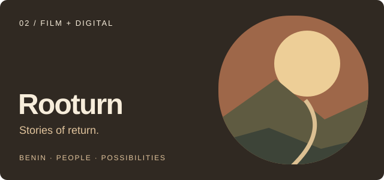
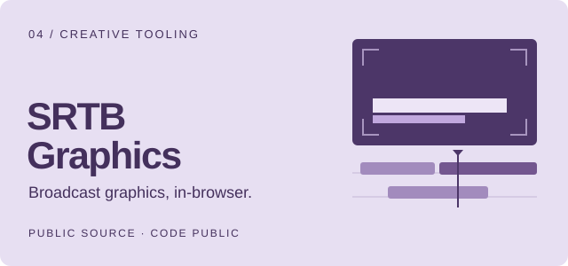

  

  <a href="https://jimmyaiproductbuilder.vercel.app"><strong>Portfolio ↗</strong></a> &nbsp; · &nbsp;
  <a href="#selected-work--projets"><strong>Selected work / Projets</strong></a> &nbsp; · &nbsp;
  <a href="README.fr.md"><strong>Français</strong></a>

I’m **Jimmy**, an **AI & Product Builder** with a background in audiovisual storytelling. I turn real-world problems into web experiences, mobile products and creative tools — using AI to explore, build and iterate.

**Je transforme des idées en produits utiles.** Mon parcours dans l’audiovisuel nourrit ma façon de concevoir : une intention claire, une expérience soignée et le souci du détail. L’IA fait partie de mes outils pour passer de l’idée au concret.

## Selected work / Projets

<table>
<tr>
<td width="50%" valign="top">

### MonAdresse

**Make places easier to find.** Create and share a digital address with landmarks, photos and voice directions.

Une adresse claire à partager, enrichie de repères, de photos et d’indications audio.

[Explore the product / Découvrir ↗](https://www.monadresse.co/)

Web & mobile product · Public presentation · Private source

</td>
<td width="50%" valign="top">

### Rooturn

**Stories of return.** A documentary project exploring Benin, personal journeys and the futures people choose to build.

Un projet documentaire sur le Bénin, les parcours de retour et les vies qui se réinventent. Réalisation : Jimmy de Souza.

[Visit the website / Voir le site ↗](https://rooturn.vercel.app)

Website live · First film available · Documentary project in progress

</td>
</tr>
<tr>
<td width="50%" valign="top">

### SRTB · Web platform

**A new home for broadcast content.** A website bringing together news, live TV, replays, podcasts and programmes, with a CMS for editorial teams.

Une nouvelle expérience média qui réunit actualité, direct, replay, podcasts et programmes.

[Vercel preview / Aperçu Vercel ↗](https://site-srtb.vercel.app/)

Public Vercel preview · Ahead of the official launch 
Aperçu Vercel accessible au public · Avant le lancement officiel

</td>
<td width="50%" valign="top">

### SRTB Graphics

**From a programme brief to a reviewed video.** A browser-based broadcast graphics studio, with public source and technical documentation.

Un studio web d’habillage TV : du brief programme à la vidéo à valider. Code public et documentation technique.

[Explore the repository / Voir le dépôt ↗](https://github.com/jimdsz/srtb-graphics)

React · TypeScript · WebCodecs · Cloudflare

</td>
</tr>
</table>

## How I build / Ma façon de construire

**Understand → Design → Build → Refine** 
Comprendre le besoin → Concevoir l’expérience → Construire → Affiner.

- **Product first.** Start with a useful problem. / Partir d’un besoin concret.
- **AI as a working tool.** Explore options, prototype and iterate. / Explorer, prototyper et itérer avec l’IA.
- **Care in the details.** Clear interfaces, thoughtful interactions and responsible data handling. / Des interfaces claires, des interactions soignées et des données protégées.

  <code>TypeScript</code> &nbsp; <code>React / Next.js</code> &nbsp; <code>React Native / Expo</code> &nbsp; <code>AI-assisted building</code> &nbsp; <code>Storytelling</code>

---

<strong>Useful products. Thoughtful experiences. Stories that matter.</strong> Des produits utiles. Des expériences soignées. Des histoires qui comptent.  <a href="https://jimmyaiproductbuilder.vercel.app">Discover my work / Découvrir mon univers ↗</a>

